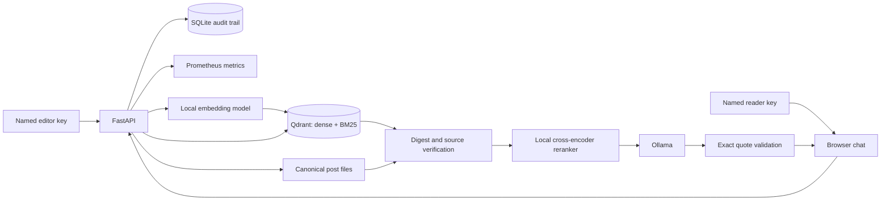

# Secure Local RAG Agent

A runnable teaching project for searching local posts and generating cited answers or insights. It uses Qdrant for dense and BM25 sparse retrieval with reciprocal rank fusion (RRF), local sentence embeddings and cross-encoder reranking, and Ollama for generation. The post files on disk are the authoritative source; Qdrant is a rebuildable index.

## Architecture



Create or update a post through `PUT /posts/{id}`: the API validates it, writes its canonical JSON file atomically, chunks it, embeds each chunk locally, and indexes dense and BM25 representations in Qdrant. Delete removes the file first, then removes indexed points. A failed index operation returns `503`; run `POST /admin/reindex` to reconcile. This endpoint also clears orphaned index entries and rebuilds all existing posts. Use one API worker for this demo: concurrent writes to the same post are not serialized.

A search embeds the query, runs two Qdrant prefetches, merges them with RRF, verifies candidates against their current local post and digest, and reranks verified candidates with a cross-encoder. The audit trace snapshots all fused candidates (up to 40), their payloads and scores, which 20 were considered for reranking, and the final sources. Answer and insight requests ask Ollama to select exact excerpts. The server accepts only strict JSON containing verbatim substrings of the cited, verified passages. It retries an invalid model output once, then quotes the top verified passage. With no verified match, it returns an insufficient-evidence response. This sacrifices free-form synthesis to prevent unsupported model prose from reaching the user; an exact quote can still reflect an inaccurate or malicious source.

Retrieval reads, validates, and hashes each distinct post once per search, even when several candidate chunks come from that post. This avoids repeated disk access and hashing without weakening the chunk checks.

## Requirements

- Python 3.11–3.13, Docker Compose, and enough disk/RAM for Qdrant, Ollama, and two local sentence models.
- Internet access on first run to download the Python packages and models; subsequent inference stays local.
- The default Ollama model is `llama3.2:3b`. Pull it before asking questions.

## Quick start: local API

Create `.env` from the example. On Windows PowerShell, use `Copy-Item .env.example .env` instead of `cp`.

```bash
cp .env.example .env
```

Create individual reader/editor keys and a separate audit signing key before starting the API:

```bash
python scripts/setup_security.py
```

This creates ignored files `data/api_keys.json` and `data/audit.key`. Keep them private and backed up. Each person needs their own entry in the key file; restart the API after editing it. An editor's post `author` must match their authenticated ID and be in `RAG_ALLOWED_AUTHORS`. Do not commit either file. Then start Qdrant:

```bash
docker compose up -d qdrant
```

Choose **one** Ollama setup:

- If Ollama is already installed and running locally, use `ollama pull llama3.2:3b`.
- Otherwise run `docker compose up -d ollama`, then `docker compose exec ollama ollama pull llama3.2:3b`.

Starting the Compose Ollama service while a local Ollama already uses port `11434` will fail. If you prefer an installed model shown by `ollama list` (or `docker compose exec ollama ollama list`), set `RAG_OLLAMA_MODEL` in `.env` to that model name. The API must be restarted after changing `.env`.

Install the API and seed the sample posts:

```bash
python -m venv .venv
# Activate .venv using your shell's normal activation command.
python -m pip install -e ".[dev]"
python scripts/seed.py
uvicorn secure_rag.api:app --host 127.0.0.1 --port 8000
```

On Windows PowerShell, activate with `.venv\Scripts\Activate.ps1`. The first seed or query downloads local embedding/reranker models and may take several minutes. `scripts/seed.py` is safe to rerun; it replaces the same sample posts.

Open `http://127.0.0.1:8000/` for the chat interface. Enter your personal reader or editor key in the access-key field, then ask a question. The key stays in page memory and is sent only with API calls; a page reload clears it. Switch between **Answer** and **Insights** and open the numbered citations to inspect source passages. Conversations remain in the current page only; each question is answered independently. The API documentation remains at `/docs`.

For a containerized API instead, run `docker compose --profile full up -d --build` after creating `.env` and the security files, pull the Ollama model as above, then run `docker compose --profile full exec api python scripts/seed.py`. Containerized API startup downloads models into the persistent `models_data` volume. The security files are mounted read-only; the audit database and anchor persist in `audit_data`.

## Try it

Run these commands **from another terminal after the API starts**. First confirm `http://127.0.0.1:8000/health` returns `{"status":"ok"}`. Run `python scripts/seed.py` once to add the sample posts. For `/answer` and `/insights`, the configured Ollama model must be available (`ollama list` for local Ollama or `docker compose exec ollama ollama list` for the container). The first query may take a while while local models download.

### Windows PowerShell

```powershell
$base = 'http://127.0.0.1:8000'
Invoke-RestMethod "$base/health"
$readerKey = Read-Host 'Enter your reader key from data/api_keys.json'
$readerHeaders = @{ 'X-API-Key' = $readerKey }

$question = @{ query = 'Why combine dense search and BM25?' } | ConvertTo-Json
Invoke-RestMethod "$base/search" -Method Post -ContentType 'application/json' -Headers $readerHeaders -Body $question
Invoke-RestMethod "$base/answer" -Method Post -ContentType 'application/json' -Headers $readerHeaders -Body $question
Invoke-RestMethod "$base/insights" -Method Post -ContentType 'application/json' -Headers $readerHeaders -Body $question

$editorKey = Read-Host 'Enter your editor key from data/api_keys.json'
$headers = @{ 'X-API-Key' = $editorKey }
$post = @{ id = 'new-post'; title = 'Example'; author = 'demo-editor'; body = 'A new example post.' } | ConvertTo-Json
Invoke-RestMethod "$base/posts/new-post" -Method Put -ContentType 'application/json' -Headers $headers -Body $post
Invoke-RestMethod "$base/posts/new-post" -Method Delete -Headers $headers
```

### Bash (macOS/Linux)

```bash
base=http://127.0.0.1:8000
curl --fail-with-body -sS "$base/health"
read -rsp 'Enter reader key from data/api_keys.json: ' reader_key; printf '\n'
curl --fail-with-body -sS "$base/search" -H 'Content-Type: application/json' -H "X-API-Key: $reader_key" -d '{"query":"Why combine dense search and BM25?"}'
curl --fail-with-body -sS "$base/answer" -H 'Content-Type: application/json' -H "X-API-Key: $reader_key" -d '{"query":"Why combine dense search and BM25?"}'
curl --fail-with-body -sS "$base/insights" -H 'Content-Type: application/json' -H "X-API-Key: $reader_key" -d '{"query":"Why combine dense search and BM25?"}'

read -rsp 'Enter editor key from data/api_keys.json: ' editor_key; printf '\n'
curl --fail-with-body -sS -X PUT "$base/posts/new-post" -H 'Content-Type: application/json' -H "X-API-Key: $editor_key" -d '{"id":"new-post","title":"Example","author":"demo-editor","body":"A new example post."}'
curl --fail-with-body -sS -X DELETE "$base/posts/new-post" -H "X-API-Key: $editor_key"
```

A `401` means the key is missing or invalid; `403` means a reader key was used for an editor operation. A connection error means the API is not running at that address. If you use another Ollama model, set `RAG_OLLAMA_MODEL` in `.env` and restart the API. `PUT`, `DELETE`, and `/admin/reindex` require an editor key; `/search`, `/answer`, and `/insights` accept reader or editor keys. Health, metrics, and static assets are public on the bound interface. Change `RAG_ALLOWED_AUTHORS` to a comma-separated list to allow more post authors. `RAG_POSTS_DIR` must be writable by the API process.

## Performance and observability

The API processes a request only after writing a durable `start` event. A post creation, deletion, or reindex gets an additional `intent` event **before** canonical files or the index change. The API buffers the response until its `complete` event commits; if audit writing fails, it returns `503` instead of a success response. A mutation can still occur before a completion failure, but its intent remains recorded. The `X-Request-ID` header links a response to all its events. An in-flight crash may leave a start or intent without a completion; this is evidence of an unfinished request, not proof of success.

Events in `RAG_AUDIT_DB` (default `data/audit/events-v2.sqlite3`) include UTC time, method, path, status, duration, direct client IP, named actor, and request details. Questions and displayed answers/sources are recorded. The trace includes retrieval settings, model names and client-library versions, all fused candidates and their payloads, verification and reranking decisions, exact prompts, raw model outputs, and validation outcomes. Editor intents include the submitted post or target ID. Authentication failures and validation errors are recorded with request metadata; invalid bodies cannot always be parsed. API key headers are never stored.

Each event is linked to the previous event with an HMAC-SHA256 computed using the separate `data/audit.key` file. A head anchor beside the database detects edits and removal of the final row when the anchor remains intact. The API verifies the chain on startup and after external database changes. An integrity failure stops request handling. Verify the entire chain and inspect recent events with:

To inspect recent events:

```bash
python scripts/audit_report.py --limit 20
python scripts/audit_report.py --verify-only
# Containerized API:
docker compose --profile full exec api python scripts/audit_report.py --limit 20
```

The database and anchor are ignored by Git and kept in the `audit_data` Docker volume. **They contain user questions, answers, source passages, candidate payloads, raw model outputs, and editor posts:** restrict access, set a retention policy, and protect exported reports. The HMAC detects edits by someone who can change SQLite but cannot access the signing key. It does **not** prove who used a key, prevent key sharing, survive compromise of the signing key, or defeat rollback of both database and anchor to a previously valid pair. For stronger enterprise evidence, anchor heads in an independent append-only service. Existing `events.sqlite3` logs are legacy and cannot be retroactively verified; the new chain starts in `events-v2.sqlite3`.

`GET /metrics` exposes Prometheus-format request counts, request-duration histograms, answer outcomes, and stage-duration histograms for embedding, Qdrant hybrid search, source verification, reranking, post embedding, model loading, and each Ollama generation attempt. Labels use fixed stage names and route templates, not questions, post IDs, or other high-cardinality values. Check it with `curl http://127.0.0.1:8000/metrics` (or `Invoke-RestMethod "$base/metrics"` in PowerShell). It is unauthenticated, so keep it on localhost or protect it at a reverse proxy. Metrics reset when the API restarts; the audit database persists.

For a slow question, compare `rag_stage_duration_seconds` across stages and `rag_http_request_duration_seconds` for `/answer` or `/insights`. First use downloads and loads the embedding and reranking models; these are measured separately. Ollama generation time depends heavily on the selected model and hardware, and an invalid selection can trigger a second generation pass. Use a smaller local model if generation dominates. The demo still indexes synchronously and runs with one API worker; response buffering and durable audit writes add latency. Production systems should move indexing to a durable queue, set latency targets, and benchmark with realistic post volumes.

## Security model and limits

This is a **local demo**, not a hardened multi-user service. Keep the API, Qdrant, and Ollama bound to localhost or a trusted network. Reader and editor keys give named attribution but are bearer credentials; anyone with a copied key can impersonate its owner. If you expose it, add an identity provider, rate limits, TLS, central audit retention, and independently stored audit anchors.

- **Trusted ingestion:** IDs are path-safe; author names must be allowlisted; posts have size limits; obvious instruction and exfiltration patterns are rejected. These patterns are illustrative and cannot catch every prompt injection.
- **Provenance:** every chunk includes the canonical post digest. Retrieval re-reads the post and checks its ID, author, title, digest, chunk number, and exact text. Deleting or changing a post invalidates old search results immediately, even if Qdrant cleanup fails.
- **Prompt boundary:** retrieved passages are treated as untrusted evidence, not instructions. Ollama selects exact excerpts in a strict JSON shape; the API rejects any additional prose, changed quote, or invalid source number. This proves only that displayed factual text occurs in the cited verified passage. It does not prove that the passage itself is true or relevant.
- **Trust boundary:** anyone who can edit the canonical post directory, environment, or running services is trusted. Digest checks are consistency checks, not signatures. Protect that directory with OS permissions. There is no malware scanning, semantic claim verification, or model-level guarantee against indirect prompt injection.
- **Operational limits:** indexing is synchronous and single-worker; Qdrant and the post filesystem do not share a transaction. Reindex after failures. Audit has no built-in retention or independently anchored head. Model tags can change; the trace records configured names, response model tags and library versions, but exact weight digests are not pinned for deterministic replay. For production, use a durable event/outbox queue, pinned model artifacts, signed provenance, per-tenant authorization, a managed audit sink, monitoring, and adversarial evaluations.

## Configuration and tests

See [`.env.example`](.env.example) for all settings. The collection name is fixed in code; if you change the embedding model dimension, use a new collection name or delete the old collection and reindex. No API key or post data is committed: `.env`, `data/api_keys.json`, `data/audit.key`, `data/posts/`, `data/audit/`, downloaded models, and local Qdrant data are ignored.

```bash
pytest -q
ruff check .
```

The unit tests use fake Qdrant and model objects, so they do not require running containers. End-to-end behavior needs the services and downloaded models from the quick start.

## References

- [Qdrant hybrid search and RRF](https://qdrant.tech/documentation/search-tuning/hybrid-search/)
- [Qdrant BM25 server-side inference](https://qdrant.tech/documentation/inference/inference-bm25/)
- [Ollama API](https://docs.ollama.com/api)

MIT licensed. See [`LICENSE`](LICENSE).
