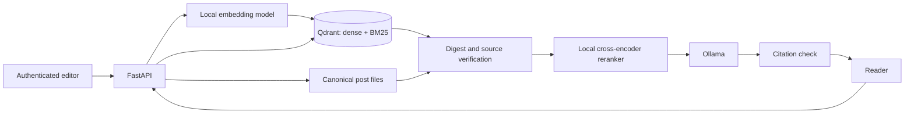

# Secure Local RAG Agent

A runnable teaching project for searching local posts and generating cited answers or insights. It uses Qdrant for dense and BM25 sparse retrieval with reciprocal rank fusion (RRF), local sentence embeddings and cross-encoder reranking, and Ollama for generation. The post files on disk are the authoritative source; Qdrant is a rebuildable index.

## Architecture



Create or update a post through `PUT /posts/{id}`: the API validates it, writes its canonical JSON file atomically, chunks it, embeds each chunk locally, and indexes dense and BM25 representations in Qdrant. Delete removes the file first, then removes indexed points. A failed index operation returns `503`; run `POST /admin/reindex` to reconcile. This endpoint also clears orphaned index entries and rebuilds all existing posts. Use one API worker for this demo: concurrent writes to the same post are not serialized.

A search embeds the query, runs two Qdrant prefetches, merges them with RRF, verifies every candidate against its current local post and digest, and reranks verified candidates with a cross-encoder. Answer and insight requests pass numbered evidence to Ollama and accept a response only when it cites valid source numbers. No match, or an uncited answer, produces an explicit insufficient-evidence response.

## Requirements

- Python 3.11–3.13, Docker Compose, and enough disk/RAM for Qdrant, Ollama, and two local sentence models.
- Internet access on first run to download the Python packages and models; subsequent inference stays local.
- The default Ollama model is `llama3.2:3b`. Pull it before asking questions.

## Quick start: local API

```bash
cp .env.example .env
# Replace RAG_WRITE_KEY with a long random value before accepting writes.
docker compose up -d qdrant ollama
docker compose exec ollama ollama pull llama3.2:3b
python -m venv .venv
# Activate .venv using your shell's normal activation command.
python -m pip install -e ".[dev]"
python scripts/seed.py
uvicorn secure_rag.api:app --host 127.0.0.1 --port 8000
```

On Windows PowerShell, use `Copy-Item .env.example .env`, then `.venv\Scripts\Activate.ps1`. Open `http://127.0.0.1:8000/docs` for the interactive API. The first seed or query downloads local embedding/reranker models and may take several minutes. `scripts/seed.py` is safe to rerun; it replaces the same sample posts.

For a containerized API instead, run `docker compose --profile full up -d --build` after setting `.env`, pull the Ollama model as above, then run `docker compose --profile full exec api python scripts/seed.py`. Containerized API startup downloads models into the persistent `models_data` volume.

## Try it

```bash
curl -X POST http://127.0.0.1:8000/search -H "Content-Type: application/json" -d '{"query":"Why combine dense search and BM25?"}'
curl -X POST http://127.0.0.1:8000/answer -H "Content-Type: application/json" -d '{"query":"How is an indexed post verified?"}'
curl -X POST http://127.0.0.1:8000/insights -H "Content-Type: application/json" -d '{"query":"What are the main retrieval and integrity lessons?"}'
curl -X PUT http://127.0.0.1:8000/posts/new-post -H "Content-Type: application/json" -H "X-API-Key: YOUR_WRITE_KEY" -d '{"id":"new-post","title":"Example","author":"demo-editor","body":"A new example post."}'
curl -X DELETE http://127.0.0.1:8000/posts/new-post -H "X-API-Key: YOUR_WRITE_KEY"
```

PowerShell users can send the same requests through the Swagger page or `Invoke-RestMethod`. `PUT`, `DELETE`, and `/admin/reindex` require `X-API-Key`; reads do not. The server refuses writes when `RAG_WRITE_KEY` is empty. Change `RAG_ALLOWED_AUTHORS` to a comma-separated list to allow more post authors. `RAG_POSTS_DIR` must be writable by the API process.

## Security model and limits

This is a **local demo**, not a hardened multi-user service. Keep the API, Qdrant, and Ollama bound to localhost or a trusted network. The API key protects post mutations, but the read endpoints are public to anyone who can reach the API. If you expose it, add authentication, rate limits, TLS, audit logging, and a proper identity system.

- **Trusted ingestion:** IDs are path-safe; author names must be allowlisted; posts have size limits; obvious instruction and exfiltration patterns are rejected. These patterns are illustrative and cannot catch every prompt injection.
- **Provenance:** every chunk includes the canonical post digest. Retrieval re-reads the post and checks its ID, author, title, digest, chunk number, and exact text. Deleting or changing a post invalidates old search results immediately, even if Qdrant cleanup fails.
- **Prompt boundary:** retrieved passages are treated as untrusted evidence, not instructions. Ollama is told to cite numbered sources; output with missing or nonexistent citation numbers is rejected. This is a guardrail, not a proof that each claim is truly supported.
- **Trust boundary:** anyone who can edit the canonical post directory, environment, or running services is trusted. Digest checks are consistency checks, not signatures. Protect that directory with OS permissions. There is no malware scanning, semantic claim verification, or model-level guarantee against indirect prompt injection.
- **Operational limits:** indexing is synchronous and single-worker; Qdrant and the post filesystem do not share a transaction. Reindex after failures. For production, use a durable event/outbox queue, signed provenance, per-tenant authorization, monitoring, and an evaluation suite with adversarial documents.

## Configuration and tests

See [`.env.example`](.env.example) for all settings. The collection name is fixed in code; if you change the embedding model dimension, use a new collection name or delete the old collection and reindex. No API key or post data is committed: `.env`, `data/posts/`, downloaded models, and local Qdrant data are ignored.

```bash
pytest -q
ruff check .
```

The unit tests use fake Qdrant and model objects, so they do not require running containers. End-to-end behavior needs the services and downloaded models from the quick start.

## References

- [Qdrant hybrid search and RRF](https://qdrant.tech/documentation/search-tuning/hybrid-search/)
- [Qdrant BM25 server-side inference](https://qdrant.tech/documentation/inference/inference-bm25/)
- [Ollama API](https://docs.ollama.com/api)

MIT licensed. See [`LICENSE`](LICENSE).
